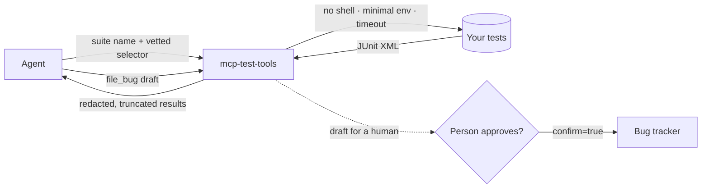

<div align="center">

# 🧪 mcp-test-tools

**An MCP server that lets an AI agent run tests, read the results and file bugs, with safe defaults.**


</div>

---

## Why this exists

Agents are good at reading a failing test and reasoning about it, but handing them a shell is risky: they can run anything, leak tokens to the code under test, or flood your bug tracker. This server gives an agent exactly the verbs a QA engineer needs, and nothing more:

> **run** a suite → **read** what failed and why → **file** a bug a human has approved

It speaks the [Model Context Protocol](https://modelcontextprotocol.io), so any MCP-compatible client or agent framework can use it.

## What an agent can do

| Tool | What it does |
|:--|:--|
| `list_suites` | Show the suites a human configured, and whether each accepts a selector |
| `run_tests` | Start a suite (optionally narrowed with `-k`, `-m`, a path...) and wait up to N seconds |
| `get_run_status` | Status and counts of a run; can wait for it to finish |
| `list_runs` | Recent runs |
| `get_results` | Failed (default), passed, skipped or all results of a run |
| `get_test_details` | Failure message, stack trace and captured output for one test |
| `get_run_log` | The end of the raw console output, for runs that crashed before reporting |
| `compare_runs` | New failures, fixed tests and still-failing tests between two runs |
| `file_bug` | Draft a bug for a failed test, and file it only after `confirm=true` |
| `list_bugs` | Bugs filed through this server |
| prompt `triage_failures` | A ready-made, human-in-the-loop triage workflow |

## How it keeps an agent safe



| Risk | Control |
|:--|:--|
| Agent runs arbitrary commands | It picks a **suite name**; commands live in a config a human wrote, run **without a shell** |
| Argument injection via the selector | Only allow-listed options (`-k`, `-m`, `-x`, `--maxfail` by default); rejects `..`, absolute paths, drive letters, backslashes and shell metacharacters |
| Tokens leak into the code under test | Tests run with a **minimal environment**; `GITHUB_TOKEN`, `JIRA_API_TOKEN` and the rest are not passed unless you list them |
| Runaway or hung runs | Per-suite timeout (the whole process tree is killed) and a concurrent-run limit |
| Bug-tracker flooding | `file_bug` is a **draft until `confirm=true`**, deduplicates by failure fingerprint, and has a per-run cap |
| Secrets in bug reports | API keys, bearer tokens, `password=...`, card numbers and emails are redacted from everything returned and filed |
| Prompt injection through test output | Results carry an explicit "untrusted data" note, the server's instructions say so, and nothing in test output can trigger an action |
| Path tricks via run ids | Run ids are validated against a strict pattern |

## Quick start

```bash
git clone https://github.com/TheByteCodeHQ/mcp-test-tools.git
cd mcp-test-tools
python -m venv .venv && source .venv/bin/activate      # Windows: .venv\Scripts\activate
pip install -e ".[dev]"
cp mcp-test-tools.example.toml mcp-test-tools.toml     # Windows: copy ...
```

The example config points at a small sample project with two deliberate failures. Start the server (stdio):

```bash
mcp-test-tools --config mcp-test-tools.toml
```

### Connect a client

Add it to any MCP client that launches servers over stdio. The shape is usually:

```json
{
  "mcpServers": {
    "test-tools": {
      "command": "mcp-test-tools",
      "args": ["--config", "/absolute/path/to/mcp-test-tools.toml"]
    }
  }
}
```

Use the full path to the `mcp-test-tools` executable (or `python -m mcp_test_tools`) if it is inside a virtual environment. For a networked client use `--transport streamable-http --host 127.0.0.1 --port 8000`, and keep it on localhost unless you add authentication in front.

### A session

```text
you:    Run the sample suite and tell me what's broken.
agent:  run_tests(suite="sample")                -> completed, 2 failed, 6 passed, 1 skipped
        get_results(run_id=...)                  -> 2 failures
        get_test_details(...)                    -> "DID NOT RAISE ValueError", "gateway returned 502"
        "Two real failures: negative total for a 150% discount, and the gateway stub returns 502."
you:    File the first one.
agent:  file_bug(run_id=..., test_id=...)        -> status: draft   (shows you the draft)
you:    Looks good.
agent:  file_bug(..., confirm=true)              -> status: filed, BUG-0001
agent:  file_bug(..., confirm=true)              -> status: duplicate of BUG-0001
```

## Configuration

```toml
[suites.unit]
description = "Unit tests"
command = ["{python}", "-m", "pytest", "-q", "--junitxml={junit}"]   # must write JUnit XML to {junit}
cwd = "."
allow_selector = true
allowed_flags = ["-k", "-m", "-x", "--maxfail"]
timeout_seconds = 300
# env_passthrough = ["BASE_URL"]

[bugs]
backend = "local"        # local | github | jira
max_per_run = 5
```

Any runner that can emit **JUnit XML** works (pytest, Maven Surefire, TestNG, Jest with a reporter, and so on), because results are read from that file, not from console text.

### Bug backends

| Backend | Needs | Duplicate detection |
|:--|:--|:--|
| `local` (default) | nothing, writes Markdown files | local index |
| `github` | `GITHUB_TOKEN`, `github_repo = "owner/name"` | local index + issue search |
| `jira` | `JIRA_BASE_URL`, `JIRA_EMAIL`, `JIRA_API_TOKEN`, `jira_project` | local index only |

Credentials come from the environment, never from the config file.

## Project layout

```text
src/mcp_test_tools/
  server.py    MCP tools, prompt and CLI
  runner.py    suite execution, selector vetting, run store
  junit.py     JUnit XML parsing
  bugs.py      drafts, fingerprints, dedupe, local / GitHub / Jira backends
  redact.py    secret and personal-data redaction
  config.py    TOML config and validation
examples/sample-project/   pytest project with deliberate failures
tests/                     55 tests, including real MCP protocol runs
```

## Tests

```bash
pytest
ruff check .
```

The suite covers the selector rules (including injection attempts), the real execution of the sample project, timeouts and process cleanup, environment isolation, redaction, bug dedupe and caps, and the MCP protocol both in-process and through a real stdio subprocess.

## Honest limits

- Tested through the MCP SDK's own client, in-process and over stdio. It has not been tried against every desktop client or agent framework.
- GitHub and Jira calls are tested against mocked HTTP, not live accounts. Jira duplicate detection uses the local index only.
- Runs are tracked by the server process. If the server restarts mid-run, that run is reported as `lost`.
- Redaction is pattern-based. It lowers risk but cannot guarantee that no secret ever appears in output.
- Only the suites you configure can run, but those suites are real code with real side effects. Point them at safe environments.

## Roadmap

- Rerun-failed tool and flaky-test detection across runs
- Live Jira duplicate search
- Result history and trend resources
- Optional token authentication for the HTTP transport

## License

MIT
